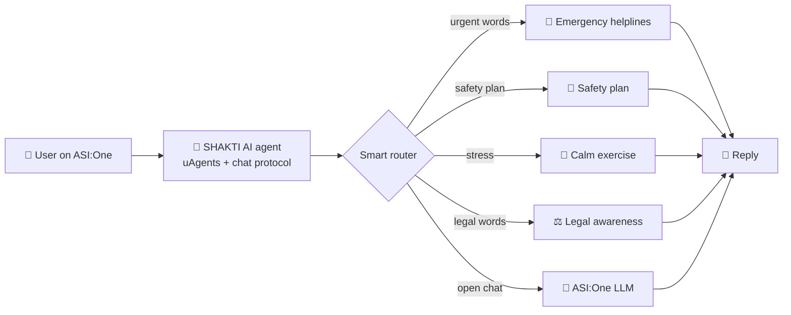

# 🛡️ SHAKTI AI — AI Assistant for Women's Safety and Support

> **Every woman. Every state. One message away.**

SHAKTI AI is an AI agent that helps women with **personal safety, emergency helplines, legal awareness and emotional support**, all in one simple chat on **ASI:One**.

It was built by **Team fetchathon3.0-4672** for **Fetch-A-Thon 3.0**, using the **Fetch.ai uAgents** framework and the **ASI:One LLM**.

> 🤝 **Credit:** SHAKTI AI is built on the open-source **Daya** project by **Riya Rahim** (MIT License). Our team added state and UT coverage, safety planning, calm exercises, legal awareness, urgent-phrase detection, city detection and the ASI:One mailbox setup.

---

## 🔗 Live Links

| What | Link |
|---|---|
| 🤖 Agentverse agent profile | `[add your Agentverse profile URL]` |
| 💬 ASI:One shared chat | `[add your ASI:One shared chat URL]` |
| 🎥 Demo video | `[add your demo video URL]` |
| 📊 Pitch deck | `[add your pitch deck URL]` |

---

## 🎯 Why SHAKTI AI?

When a woman feels unsafe, every second counts. But:

- 📞 Helpline numbers are different in every state and hard to find in a panic.
- ⚖️ Legal information is full of hard words.
- 💬 Many women have no one to talk to at that moment.

**SHAKTI AI solves this in one chat.** She types in her own words. She gets the right numbers, a safety plan, legal awareness or calm support.

---

## ✨ Features

| | Feature | What it does |
|---|---|---|
| 🛡️ | **Emergency Helpline Finder** | Gives 5 national helplines (including 112) and local contacts when it finds a state, UT or major city in the message. |
| 🚨 | **Urgent Phrase Detection** | Recognizes 20+ urgent phrases (for example "I feel unsafe") and replies at once with fixed, safe text. |
| 🧭 | **Personal Safety Planning** | Shares simple steps: a safer place, a trusted person, one number to memorize. |
| 💜 | **Emotional Support** | Gives a short grounding exercise for stress and anxiety. |
| ⚖️ | **Legal Awareness** | Explains legal aid, reporting options and One Stop Centres in plain words. |
| 🗺️ | **State and UT Coverage** | Recognizes all 36 states and UTs. Cities like Bangalore, Mumbai and Chennai map to their state. |
| 🧠 | **Conversation Memory** | Remembers the last 10 messages for each user. |
| 🌐 | **Open Chat with ASI:One** | Answers other questions on safety, health, motivation and wellbeing with the `asi1-mini` model, under strict safety rules. |

### 🔒 Our main idea: no AI guessing in an emergency

For urgent topics (emergency, safety plan, calm exercise, legal awareness), SHAKTI AI sends **fixed, checked text**. Only open conversation goes to the LLM. This keeps the most important answers safe and predictable.

---

## 🏗️ How It Works



**Step by step:**

1. The user sends a message on ASI:One.
2. The agent sends an acknowledgement and saves the message to memory.
3. It finds the state or city and checks for urgent words.
4. Urgent topics get fixed, safe replies. Open chat goes to the ASI:One LLM.
5. The reply returns in the same chat.

---

## 🧰 Built With

| Component | Technology |
|---|---|
| Language | Python |
| Agent framework | [Fetch.ai uAgents](https://github.com/fetchai/uAgents) |
| Chat | uAgents chat protocol |
| Language model | [ASI:One](https://asi1.ai), model `asi1-mini` |
| AI client | OpenAI-compatible Python client |
| Hosting | Agentverse mailbox |
| Memory | In-memory chat history (last 10 messages per user) |

---

## 🚀 Getting Started

### ✅ Prerequisites

- Python **3.10 or newer**
- An **ASI API key**
- An **Agentverse** account (for the mailbox)

### 📥 Installation

```bash
git clone https://github.com/anantagarwal1307/SHAKTI-AI.git
cd SHAKTI-AI
python -m venv venv
```

Activate the environment:

```bash
# Windows
venv\Scripts\activate

# Linux or macOS
source venv/bin/activate
```

Install the dependencies:

```bash
pip install -r requirements.txt
```

### 🔑 Set environment variables

You need two private values. **Never commit them to GitHub.**

| Variable | Meaning |
|---|---|
| `ASI_API_KEY` | Your ASI:One API key |
| `AGENT_SEED` | A long random phrase (5 or 6 random words). It controls your agent's identity. |

**Windows PowerShell:**

```powershell
$env:ASI_API_KEY="YOUR_ASI_API_KEY"
$env:AGENT_SEED="your long random words here"
```

**Linux or macOS:**

```bash
export ASI_API_KEY="YOUR_ASI_API_KEY"
export AGENT_SEED="your long random words here"
```

### ▶️ Run the agent

```bash
python agent.py
```

Then connect it to ASI:One:

1. Open the link printed in the terminal.
2. Click **Connect**, then choose **Mailbox**.
3. Find your agent on ASI:One and start chatting.

> If the Connect step looks different, check the current [uAgents mailbox guide](https://github.com/fetchai/uAgents).

---

## 💬 Try It

| Send this message | You should get |
|---|---|
| `I feel unsafe in Bangalore. What should I do?` | National helplines and Karnataka contacts |
| `Can you provide emergency contacts for Tamil Nadu?` | National helplines and Tamil Nadu contacts |
| `Help me make a safety plan` | The personal safety plan |
| `I'm feeling anxious. Help me calm down` | The grounding exercise |
| `I need legal help` | Legal awareness information |
| `Help me with my goals` | A normal AI reply (not an emergency) |

---

## 📁 Project Structure

```text
SHAKTI-AI/
├── agent.py            # Main agent: router, helplines, features, ASI:One chat
├── requirements.txt    # Python dependencies
├── .gitignore          # Keeps secrets and local files out of Git
├── README.md           # Project documentation
└── LICENSE             # MIT License
```

---

## 🙈 .gitignore

Your seed and API key must never reach GitHub. Use the standard GitHub **Python** template and make sure it includes:

```gitignore
.env
venv/
__pycache__/
*.pyc
```

---

## 🔐 Safety and Privacy

- ✅ General information only. **Not legal advice or a medical diagnosis.**
- ✅ SHAKTI AI **never claims to call** the police or any service. It only shares numbers.
- ✅ It **never asks** for OTPs, passwords or PINs.
- ✅ Chat memory stays in the app's memory and is cleared when the program restarts.
- ✅ No live GPS tracking.
- ⚠️ Local NGO and legal-office numbers **must be verified** with official sources before real use.
- ⚠️ Women Helpline 181 is not active in every state.

SHAKTI AI supports people. It does **not replace** emergency responders, professionals or trusted people.

---

## ⚠️ Current Limits

- Local police, legal and NGO contacts are included for **Tamil Nadu, Maharashtra, Karnataka and Delhi**. Other states and UTs get national helplines.
- Detection uses keywords, so unusual wording may go to the open chat.
- Replies are in English.

---

## 🗺️ Roadmap

| Now ✅ | Next 🔜 | Later 🔭 |
|---|---|---|
| Helpline finder | Verify helplines with official sources | Voice help |
| Safety plan | Local contacts for every state and UT | Opt-in location sharing with a trusted contact |
| Calm exercise | More Indian languages | NGO and local partners |
| Legal awareness | Smarter understanding of messages | |

---

## 📚 What We Learned

- How to build an agent with **uAgents** and the **chat protocol**.
- How to connect an agent to **ASI:One** with a mailbox.
- Why fixed, checked replies are safer than AI guessing in an emergency.
- How to keep secrets out of a public repository.
- How to work together as a team under hackathon time.

---

## 👥 Team fetchathon3.0-4672

| Name | Role |
|---|---|
| **Shashank Ramesh Chandake** | Team Leader |
| **Anant Kumar Agarwal** | Team Member · B.Tech CSE, RIT Roorkee · [GitHub: anantagarwal1307](https://github.com/anantagarwal1307) |
| **Sarthak Chaurasia** | Team Member |
| **Saurabh Kumar** | Team Member |

---

## 🤝 Contributing

Contributions are welcome!

1. Fork the repository.
2. Create a branch for your change.
3. Test your change.
4. Open a pull request.

Please never commit API keys, seeds or private user data.

---

## 📄 License

This project is licensed under the **MIT License**. See the [LICENSE](LICENSE) file.

It is built on the Daya project by Riya Rahim, and her copyright notice stays in the LICENSE file.

---

> **SHAKTI AI — Empowering women through knowledge, safety, support, and AI.** 💜
